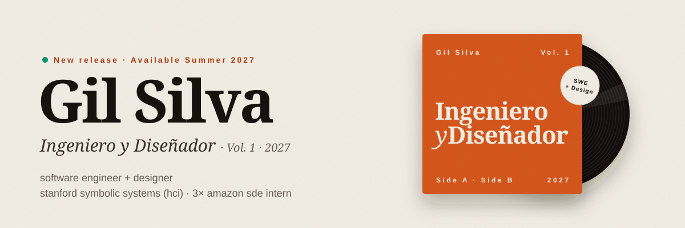

<!--
  Gil Silva · GitHub profile README
  Styled to match the portfolio: "Ingeniero y Diseñador, Vol. 1"
-->

<div align="center">

<a href="https://portfolio-one-dun-7bqa00r7vk.vercel.app"></a>

<p>
  <a href="https://portfolio-one-dun-7bqa00r7vk.vercel.app"><b>Listen to the full album ↗</b></a>
  &nbsp;·&nbsp;
  <a href="https://portfolio-one-dun-7bqa00r7vk.vercel.app/Gil_Silva_Resume.pdf">Résumé ↗</a>
  &nbsp;·&nbsp;
  <a href="https://www.linkedin.com/in/gilxsilva/">LinkedIn ↗</a>
  &nbsp;·&nbsp;
  <a href="https://instagram.com/gilxsilva">@gilxsilva</a>
</p>

</div>

### Liner notes

Born in SF, raised in Chapala, Jalisco, back in the US for Stanford. I build at the intersection of **HCI, social impact, and product**: engineering with people, not just for them.

```
Now playing    → Stanford · Symbolic Systems (HCI)
Graduating     → December 2027
Last session   → SDE intern @ Amazon SCOT (summer 2026)
Open to        → Summer 2027 internships · full-time roles from 2028
Off the record → Rugby · guitar · songwriting
```

### Side A · Work

| #   | Track | Liner notes | Year |
| --- | ----- | ----------- | ---- |
| 01  | **SDE intern** · Amazon SCOT | Serverless AWS pipeline + Bedrock LLM agent surfacing the 3.6M vendor EDI failures that never reached vendors | 2026 |
| 02  | **Full-stack SWE intern** · CollegePlanAI | Primary engineer at a 3-person startup. AI college essay app used by hundreds of students. 🏆 Acquired by New Oriental | 2025 |
| 03  | **SDE intern** · Amazon Last Mile Stops | Self-service workflow for delivery-stop investigations, cutting 8+ hrs/week of engineering toil | 2025 |
| 04  | **SDE intern** · Amazon Last Mile Flex | Location-preference signal for Flex's assignment optimizer: a Java distance matrix feeding a Python integer-program solver | 2024 |

### Side B · Projects

| #   | Track | Liner notes |
| --- | ----- | ----------- |
| 01  | [**kyro-app**](https://github.com/gilxsilva/kyro-app) · [site ↗](https://web.stanford.edu/class/cs147/projects/DesignforMentalWellbeing/Kyro/) | Emotional scheduling app: plan by energy, not just time. 🏆 Top 6 of 23, Best Concept + Most Novel Product at the Stanford CS147 expo |
| 02  | [**gem-cs278**](https://github.com/gilxsilva/gem-cs278) | Social map for discovering meaningful places through people you trust. React Native, Expo, Supabase |
| 03  | [**finding-our-voice**](https://github.com/gilxsilva/finding-our-voice) · [site ↗](https://gilxsilva.github.io/finding-our-voice/) | Bilingual site for immigrant youth. Co-founded the English-learning program at 826 Valencia, SF. 🏆 $10K grant |
| 04  | [**ols-advocacy-hub**](https://github.com/gilxsilva/ols-advocacy-hub) · [site ↗](https://gilxsilva.github.io/ols-advocacy-hub/) | Interactive look at Operation Lone Star's financial and social impact, built from a Stanford border-law course |
| 05  | [**hackharvard-2025**](https://github.com/gilxsilva/hackharvard-2025) | Chrona: an all-in-one academic dashboard, built at HackHarvard |
| 06  | [**portfolio**](https://github.com/gilxsilva/portfolio) | This album as a website: Next.js, TypeScript, Tailwind, and too many commits at 2am |

### On repeat

🎧 **She's Electric** · Oasis &nbsp;·&nbsp; More on [/now ↗](https://portfolio-one-dun-7bqa00r7vk.vercel.app/now)

<div align="center">
<sub>Encore · Hablemos · <a href="mailto:gscgilbertosilva@gmail.com">gscgilbertosilva@gmail.com</a> · Graduating Dec 2027 · Open to summer 2027 internships + full-time roles from 2028</sub>
</div>
